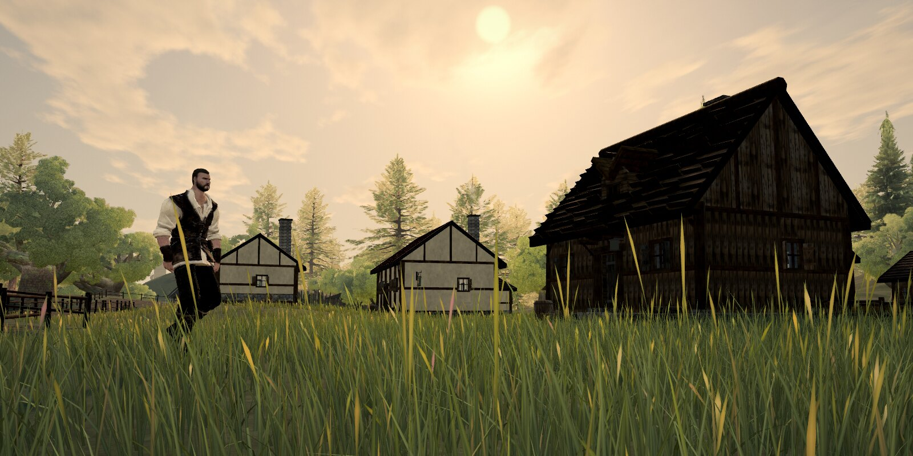

# Ael

I build games with AI coding agents and make bilingual AI lyric videos.

## Tervain

A single-player high-fantasy RPG. The prototype runs in a desktop browser today
and is being reworked into the seed for a later Unreal Engine port (5.9 or 6.0).

**[Play Tervain](https://ael-dev3.github.io/Tervain/)** · [Source](https://github.com/ael-dev3/Tervain)

## Other projects

- **[Nullmere Online](https://github.com/ael-dev3/Nullmere)**: a persistent strategy MMO for the Mac, with a native Swift and Metal client on a SpacetimeDB server. In development; no public realm yet. [Trailer](https://github.com/ael-dev3/Nullmere/releases/tag/trailer).
- **[Warpkeep](https://github.com/ael-dev3/Warpkeep)**: a persistent strategy game connected to Farcaster. Development has halted; the code and original assets remain open for reuse.

Older games, Farcaster tools and onchain data projects are listed in [Projects](PROJECTS.md).

## Contact

[X: @0xAell](https://x.com/0xAell) · [Farcaster: 0xael.eth](https://farcaster.xyz/0xael.eth)
